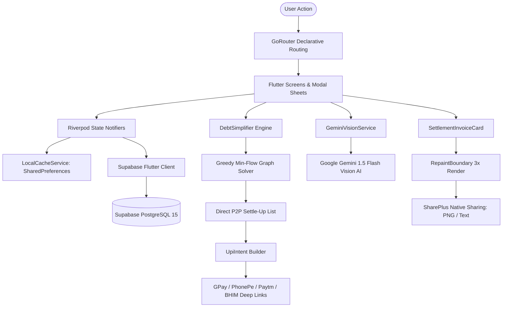

<div align="center">

# FairShare

**The Neo-Fintech Expense Sharing & P2P Settlement Engine**

*Zero-Login Quick Groups | AI-Powered Receipt Itemization | Multi-Payer Min-Flow Debt Simplification | Direct UPI Settlements*

<br/>

[](https://fairshare-beta.vercel.app)
[](https://github.com/lk-03/FairShare/releases/latest)
[](test/)
[](LICENSE)

<br/>

[](https://flutter.dev)
[](https://dart.dev)
[](https://riverpod.dev)
[](https://pub.dev/packages/go_router)
[](https://supabase.com)
[](https://ai.google.dev)
[](https://pub.dev/packages/fl_chart)
[](https://npci.org.in)

</div>

---

## Overview

**FairShare** is a next-generation neo-fintech cross-platform application engineered to eliminate the friction of shared expenses, cyclic group debts, awkward reminders, and manual bill splitting.

Engineered with **Flutter**, **Riverpod**, **GoRouter**, **Supabase**, and **Google Gemini Flash Vision AI**, FairShare brings together real-time camera receipt OCR itemization, graph-theoretical debt reduction, multi-payer split allocation, local offline quick groups, and zero-fee peer-to-peer UPI settlements into a high-performance Scandinavian minimalist fintech experience across mobile, desktop, and web.

---

## Key Features & Capabilities

### 1. Quick Groups (Zero-Login Local Offline Groups)
- **Zero Login & Instant Setup**: Track group expenses completely offline on your device without signing in, registering an account, or entering phone numbers.
- **Empty Freeform Roster**: Start with a clean slate—add friends simply by typing their names (e.g., "Rahul", "Priya") without needing emails, contacts, or join links.
- **De-Personalized Group Spend Ledger**: Clean, uncluttered ledger displaying total expense figures and `Paid by [Name]`. Balance hero displays total aggregate spend rather than personalized balances.
- **Full In-Group Member Management**: Add new people on the fly, rename participants anytime, and maintain clean group rosters.
- **Instant Settlement Invoices**: Generates high-resolution, branded visual invoice cards with 1-tap **"Share Image"** (PNG export via `RepaintBoundary`) and 1-tap **"Copy Text"** for seamless WhatsApp or Telegram settlement sharing.

### 2. AI-Powered Receipt OCR Itemizer (Google Gemini Vision)
- **Multimodal Intake**: Capture physical receipts directly via camera or select images from the gallery.
- **Automated Extraction**: Uses Google Gemini 1.5 Flash Vision to extract merchant title, date, currency, line items, and total amount with structured JSON tokenization.
- **Zero-Storage Privacy Guarantee**: Receipt images are held only ephemerally in RAM (`Uint8List`) for OCR tokenization and dereferenced immediately. Never persisted to cloud storage or device caches.

### 3. Multi-Payer Greedy Min-Flow Debt Simplification
- **Graph Reduction Algorithm**: Resolves complex, circular multi-person IOUs (e.g., A owes B, B owes C, C owes A) down to the mathematical minimum number of direct peer-to-peer transactions.
- **Multi-Payer Allocation**: Supports expenses funded across multiple group members with custom split proportions and self-balancing net ledgers.

### 4. Zero-Fee Direct UPI P2P Settlements
- **Standard OS Deep Linking**: Triggers native Indian banking and payment apps (Google Pay, PhonePe, Paytm, BHIM, CRED) using standard `upi://pay` deep link intent protocols without payment gateway fees.
- **Pre-Populated Verification**: Automatically embeds recipient VPAs, settlement amounts, and transaction tags to eliminate human entry errors.
- **Dynamic Settlement QR Codes**: Generates high-resolution vector QR codes for instant scan-and-pay from other devices or gallery imports.

### 5. Strict Zero-Balance Member Governance
- **Zero-Balance Safety Guard**: Group members cannot leave a group, and admins cannot remove members, if they have an active unsettled balance (`netBalance.abs() > 0.01`).
- **Clear Blocking Dialogs**: Explains the member's exact outstanding balance and directs them to settle debts first.

### 6. Splitwise CSV Import Engine
- **Effortless Migration**: Import past Splitwise groups and transaction logs via in-app file picker (`file_picker`) or direct clipboard paste (`CsvImportSheet`).
- **Shadow Member Mapping & History Reconstruction**: Maps CSV columns to existing members or creates shadow members with accurate historical balances.
- **Clean Android SDK 36 Compatibility**: Internalized parser avoids external OS share-sheet interceptor dependencies, ensuring 100% stable compatibility with standard Android Gradle Plugins.

### 7. Responsive Desktop & Web Experience
- **Adaptive Layouts ($>800$px)**: Widescreen two-column layouts on Group Details and Profile, a horizontal metrics header with directional net balance cards, and a dedicated desktop sidebar.
- **Centered Modal Bottom Sheets**: Centered desktop dialog constraints (`maxWidth: 640px`) preventing stretched dialogs while retaining full-bleed bottom sheets on mobile.

### 8. Direct In-App Android APK Updater
- **Streamed Background Updates**: Checks for GitHub Releases and downloads latest APKs in-app with live percentage and MB progress indicators.
- **Native Package Installer Integration**: Launches Android package installer intent directly via Kotlin method channel (`com.fairshare.app/updater`).

### 9. Expense Trash & 24-Hour Recovery
- **Accidental Deletion Protection**: Soft-deletes expenses into the Group Settings Trash with 24-hour restore capabilities before automatic database purge.

### 10. Nordic Blue & AMOLED True Black Theme System
- Understated minimalist fintech palette inspired by Scandinavian design.
- Dynamic Material 3 support for System, Light Mode, Nordic Blue Dark Mode, and **AMOLED True Black (`#000000`)**.

---

## Architecture & Data Flow



---

## Tech Stack

| Layer | Technology | Purpose |
| :--- | :--- | :--- |
| **Framework** | Flutter 3.47.2 (Dart 3.13.2) | Cross-platform high-performance client runtime |
| **State Management** | Flutter Riverpod 2.6.1 | Compile-safe reactive state architecture |
| **Routing** | GoRouter 14.8.1 | Declarative URL-driven navigation with auth guards |
| **Backend & Database** | Supabase Flutter 2.8.4 | PostgreSQL 15, Auth, Row Level Security (RLS) |
| **AI / OCR** | Google Generative AI (`google_generative_ai`) | Ephemeral receipt tokenization via Gemini 1.5 Flash Vision |
| **Visual Analytics** | `fl_chart` 1.1.1 | 60fps dynamic spending donut charts |
| **Camera & Media** | `image_picker` 1.1.2 | High-resolution receipt image capture |
| **QR Generation** | `qr_flutter` 4.1.0 | High-resolution vector settlement & invite QR codes |
| **Local Persistence** | `shared_preferences` 2.5.4 | Offline-first quick groups, caching, and preferences |
| **Sharing** | `share_plus` 10.1.4 | Native system share sheet for invoices and summaries |
| **Payments** | UPI Intent Protocol (`upi://pay`) | Zero-fee direct peer-to-peer bank settlement |
| **Web Hosting** | Vercel CI/CD | Continuous production deployment for web runtime |

---

## Directory Structure

```
FairShare/
├── android/               # Native Android Gradle configuration (SDK 36)
├── ios/                   # Native iOS Runner configuration
├── web/                   # Web embedder with Vercel configuration
├── assets/                # Application brand assets, vectors, and icons
├── supabase/              # PostgreSQL schemas, RLS policies, and Edge Functions
├── .github/               # CI test runner, APK build, and Vercel deploy workflows
├── .misc/                 # Gitignored: architecture guides, rules, & roadmap
├── lib/                   # Canonical Flutter Application Source
│   ├── main.dart          # Entrypoint with ProviderScope & Theme binding
│   ├── config/            # Routes (GoRouter) and Material 3 ThemeExtensions
│   ├── core/              # Models, Debt Simplifier algorithm, UPI Intent utilities
│   ├── data/              # Supabase services, offline repositories, Riverpod providers
│   └── features/          # Feature presentation modules:
│       ├── activity/      # Global chronological activity feed
│       ├── auth/          # Authentication & Quick Group guest launcher
│       ├── expenses/      # Creation sheets, splits, settlement sheets
│       ├── groups/        # Quick groups, group ledgers, settings & invoices
│       ├── home/          # Main dashboard, desktop metrics header
│       ├── needs/         # House cart & shared grocery checklist
│       └── profile/       # Profile management, UPI setup, CSV import
├── test/                  # 100% Passing Unit & Widget Test Suites (177 tests)
├── .env.example           # Environment variable template
├── analysis_options.yaml  # Flutter strict linter configuration
└── pubspec.yaml           # Flutter dependencies and asset manifest
```

---

## Getting Started

### Prerequisites
- **Flutter SDK**: 3.47.2 or later
- **Dart SDK**: 3.13.2 or later
- **Android Studio** (Android SDK 36) or **Xcode** (iOS) or **Chrome** (Web)

### Installation

1. **Clone the repository**:
   ```bash
   git clone https://github.com/lk-03/FairShare.git
   cd FairShare
   ```

2. **Install dependencies**:
   ```bash
   flutter pub get
   ```

3. **Configure Environment Variables**:
   Create a local `.env` file from the template:
   ```bash
   cp .env.example .env
   ```

   Add your credentials to `.env` (this file is gitignored and will never be committed):
   ```env
   # Supabase Backend Configuration
   SUPABASE_URL=https://your-project.supabase.co
   SUPABASE_ANON_KEY=your-anon-key

   # Google OAuth Native Client ID
   GOOGLE_WEB_CLIENT_ID=your-client-id.apps.googleusercontent.com

   # Google Gemini Flash Vision API Key (Free tier from Google AI Studio)
   GEMINI_API_KEY=your-gemini-api-key
   ```
   *(Note: FairShare includes full offline-first fallbacks and demo login; you can run the app locally or use Quick Groups without cloud credentials).*

4. **Run the Application**:
   ```bash
   # Run on connected mobile device or emulator
   flutter run

   # Or run on Google Chrome (Web preview)
   flutter run -d chrome
   ```

---

## Running Quality Checks & Tests

FairShare features a strict, comprehensive test suite covering business logic, Riverpod state notifiers, algorithmic debt reduction, and UI widgets:

```bash
# Static analysis (0 warnings, 0 errors)
flutter analyze

# Run all 177 unit and widget tests
flutter test
```

---

## Building Android Release APK

```bash
flutter build apk --release
```
The compiled standalone APK will be generated at:
`build/app/outputs/flutter-apk/app-release.apk`

---

## Star History

<div align="center">

[](https://star-history.com/#lk-03/FairShare&Date)

</div>

---

## License

Distributed under the MIT License. See [LICENSE](LICENSE) for more details.
